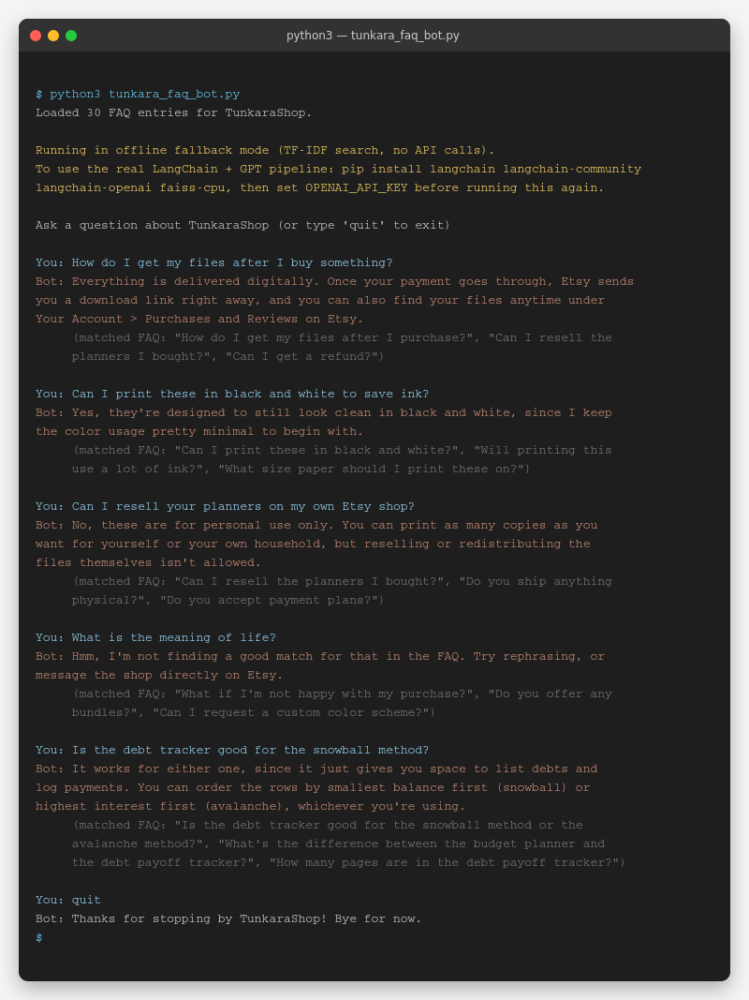

# TunkaraBot - FAQ Chatbot for TunkaraShop

A LangChain-based FAQ chatbot built for my Etsy shop, TunkaraShop. Answers
customer questions using a small FAQ dataset I wrote myself, instead of
letting an LLM guess at things it's never actually seen.

## Files

- `tunkara_faq_bot.py` - the chatbot itself
- `tunkarashop_faq.csv` - the FAQ dataset (30 question/answer pairs)

## How it works, quickly

This uses Retrieval-Augmented Generation (RAG): a user's question gets
matched against the FAQ dataset first, and only the most relevant FAQ
entries get handed to the LLM along with the question, so the answer
stays grounded in real shop info instead of the model making something up.

## Running it with the real LangChain + GPT pipeline

```
pip install langchain langchain-community langchain-openai faiss-cpu pandas scikit-learn
export OPENAI_API_KEY="your-key-here"      # on Windows: set OPENAI_API_KEY=your-key-here
python3 tunkara_faq_bot.py
```

If `langchain`, `langchain-community`, `langchain-openai`, and `faiss-cpu`
are all installed AND `OPENAI_API_KEY` is set, the script automatically
uses the real pipeline: FAISS vector store + ChatOpenAI (gpt-4o-mini).

Want to use Claude instead of GPT? Swap the `get_llm()` function in
`tunkara_faq_bot.py` to import `ChatAnthropic` from `langchain_anthropic`
instead of `ChatOpenAI` - everything else stays the same.

## Running it without an API key (offline fallback)

If LangChain isn't installed, or there's no `OPENAI_API_KEY` set, the
script drops into a fallback mode automatically: it uses scikit-learn's
TF-IDF to find the closest matching FAQ entry and returns that answer
directly, no API calls at all. This is what I used to test the retrieval
logic while building this, since I didn't have reliable API access the
whole time. Just run:

```
python3 tunkara_faq_bot.py
```

with no key set, and it'll tell you it's running in fallback mode.

## Demo

A full session in offline fallback mode, including a question the FAQ can't answer:



## Example

```
You: Can I resell your planners on my own Etsy shop?
Bot: No, these are for personal use only. You can print as many copies as
you want for yourself or your own household, but reselling or
redistributing the files themselves isn't allowed.
```

## What's out of scope for this version

- No conversation memory (each question is answered independently)
- No web interface, it's a terminal chat loop
- Only covers TunkaraShop's actual FAQ topics - it'll say so if a question
  falls outside what's in the dataset
